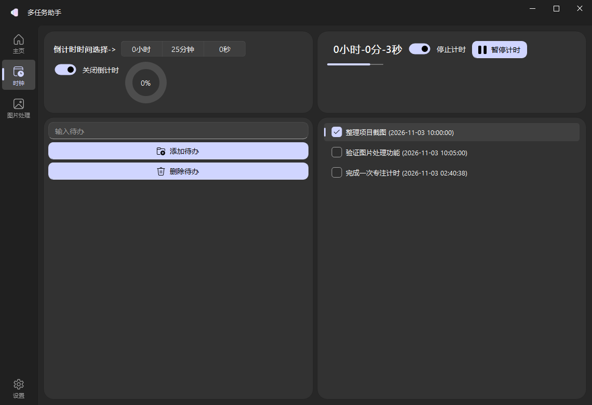
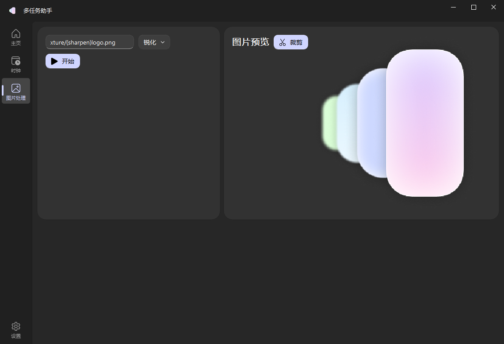

# 多任务助手 Multi-Task Assistant

基于 Python、PyQt5 与 QFluentWidgets 的 Windows 桌面工具，将计时、待办管理和图片处理集中到同一窗口。项目重点是桌面交互、Qt 组件组合、轻量数据持久化与 Pillow 图像处理，不是 Web 服务。

## 界面预览

以下为本地运行截图：使用独立工作目录与演示待办，关闭外部网络加载；不包含用户真实待办或个人照片。





## 已实现功能

| 模块 | 实现内容 |
| --- | --- |
| 计时工具 | QTimer 驱动的倒计时与正计时、暂停/恢复、进度展示 |
| 待办清单 | 添加、删除、完成状态切换，保存到工作目录下的 `todo.json` |
| 图片处理 | 拖拽或输入本地路径、旋转、缩放、模糊、锐化等滤镜及框选裁剪 |
| 处理记录 | 在 `Texture/` 生成处理结果，文件名前缀记录操作链，避免覆盖原始输入 |
| 外观设置 | 明暗主题、主题色、Windows Mica 效果开关 |
| 主页 | 城市搜索与天气查询、网络图片和本地资源展示；依赖第三方服务可用性 |

图片裁剪会将预览图上的选区映射回原图坐标。自定义 Qt 组件封装位于 `utils/MUIElements.py`，包括拖拽输入框、卡片布局、图片选区与动画辅助类。

## 环境与依赖

- 推荐 Windows 10/11、Python 3.12；Mica 等系统效果依赖 Windows 支持。
- PyQt5、Pillow、requests。
- **原开发环境使用定制的 PyQt-Fluent-Widgets 1.5.7。** 仅安装公开发行版并不保证兼容；本项目 `SwitchSettingCard` 使用了定制的 `ontext` / `offtext` 参数，标准 1.5.6 构造函数不接受这些参数。
- 仓库目前未提供该定制依赖的可分发包和完整版本锁定文件。因此不能声称在全新机器上运行一条 `pip install` 就能复现原环境，也不要用无关同名 `QFluentWidgets` 包替代。

```powershell
git clone https://github.com/baishang-ui/Multi-Task-Assistant.git
cd Multi-Task-Assistant
py -3.12 -m venv .venv
.\.venv\Scripts\Activate.ps1
python -m pip install PyQt5 Pillow requests
# 继续安装已获授权的原定制 PyQt-Fluent-Widgets 1.5.7 发行包。
# 未取得匹配组件库时，请先解决依赖问题，而不是跳过启动异常。
python Window.py
```

请从仓库根目录启动，因为资源和输出路径与当前工作目录有关。建议在副本或独立目录内试用，并先备份既有 `todo.json`。

## 代码结构

```text
Window.py                     主窗口、页面编排与交互逻辑
utils/MUIElements.py          自定义 Qt 组件
utils/Utils.py                时间转换、资源路径与文件读写
utils/GetPhotoFromInternet.py 网络图片加载
utils/GetWeather.py           城市编码与天气接口
utils/GetYiyan.py             独立的一言接口模块，未作为主功能展示
resource/                    图标、动图、城市编码与默认图片
todo.json                    本地待办数据
Texture/                     图片处理输出
window.spec                  历史 PyInstaller 配置
docs/images/                 本地演示界面截图
```

`build/`、`dist/`、`__pycache__/` 和 IDE 配置中包含历史产物，不应当作独立功能或原创依赖库。此次文档整理没有删除历史文件，也未重写已有提交。

## 验证与运行边界

- 可以使用 `python -m compileall -q Window.py utils` 检查语法；这不替代 GUI、依赖和功能验证。
- 当前仓库没有完整的自动化测试套件；截图是本地演示，不代表所有功能、网络服务和系统版本均经过验证。
- 启动阶段会尝试加载第三方网络图片，天气查询会访问外部接口。离线截图应显式禁用这些请求，并使用演示数据；不要将缺省天气或演示值标成实测数据。
- 标准 PyQt-Fluent-Widgets 1.5.6 环境中的已知启动错误为 `SwitchSettingCard.__init__() got an unexpected keyword argument 'ontext'`，原因是依赖 API 不匹配。
- 图片处理会写入本地文件。请使用自有或已获许可的测试图片，并保留原图备份。
- PyInstaller 配置是历史开发配置。重新打包前需核对入口 `Window.py` 的大小写、资源收集和依赖授权；现有 EXE 不作为当前源码构建成功的证明。

## 许可证与第三方资源

仓库根目录的 [LICENSE](LICENSE) 为 **GNU Affero General Public License v3.0（AGPL-3.0）**，以该文件为准；本项目不是旧版 README 所写的 MIT 许可。QFluentWidgets、PyQt5 和其他依赖各有其许可条件，引用的网络图片、字体及其他素材也需独立核实授权。不要将第三方库或示例资源描述为本项目独立研发成果。

## 项目链接

- [GitHub 仓库](https://github.com/baishang-ui/Multi-Task-Assistant)
- [QFluentWidgets 文档](https://qfluentwidgets.com/)
- [PyQt5 文档](https://www.riverbankcomputing.com/static/Docs/PyQt5/)
- [Pillow 文档](https://pillow.readthedocs.io/)
